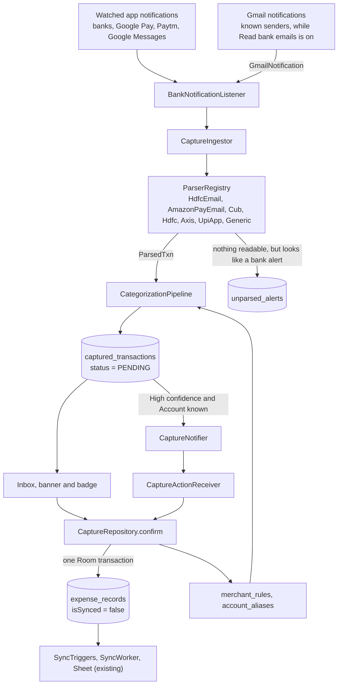

# Auto-capture

Auto-capture turns bank and UPI alerts into suggested Transactions, so they don't have to be typed in by
hand. Everything runs on the phone: no network calls, no paid services and no cloud model. The only
learning is an on-phone Naive Bayes guesser, no network.

Nothing becomes a Transaction until the user confirms it ([ADR-0005](adr/0005-auto-capture-never-confirms-itself.md)).
Alerts are read from notifications, not from the SMS database ([ADR-0007](adr/0007-auto-capture-reads-notifications-not-sms.md)).

Terms used here (Captured transaction, Confirm, Merchant rule, Account alias, Confidence band, Unparsed
alert) are defined in [CONTEXT.md](../CONTEXT.md).

## 1. What the user sees

1. **Turn it on** in More > Auto-capture: switch capture on, grant notification access (an Android system
   screen), and allow notifications so confirmations can be asked from a notification. To read HDFC's and Amazon
   Pay's alert emails too, turn on **Read bank emails** and follow its three Gmail steps (section 3).
2. **Map categories once.** The app recognises kinds of merchant (food delivery, groceries, fuel and so on)
   but only ever files into the user's own Categories. The same screen matches each kind to one of them, and
   cashback to one of their Income Categories. A kind left unmapped shows "Needs a category".
3. **Alerts arrive.** Each payment from a watched app becomes a pending capture. Its Alerts from different
   Alert sources (the bank's SMS and Google Pay's "<NAME> paid you", say) become **one** capture with the
   bank's Account and Google Pay's payer (section 5). A banner on the Trans screen
   ("3 captured transactions to review") and a badge on the Trans tab count them.
4. **Review.** To review (`CaptureInbox`, all pure) groups waiting captures **by day**, newest first, by the
   date Confirm will write (the alert's own time, in the phone's zone). Each day's header shows the date
   (Today, Yesterday, "Wed 11 Nov"), how many captures wait and the money out and in, and is a TalkBack
   heading. Each capture is a **compact row**: a band dot (High, Check, Low), the title (italic while it's
   the Suggested description), the Category (or a Transfer's other Account) and Account as pills, a guessed
   Account as "HDFC Savings?", and the amount. TalkBack reads the row as one sentence ("Lunch, ₹80, Food,
   HDFC, check, 12 November") and offers Confirm (or Same one and Add anyway), Dismiss, Edit description and
   Edit in full as custom actions. Tapping a row **expands it in place**, and only one row is expanded at a
   time. A row swiped right while something is missing springs back and expands with the gap highlighted.
   **Filters**: All, **Needs a pick** and **Ready**. Ready means a Category (or a Transfer's other Account),
   a real Account (not a guessed one) and no possible Ledger match; everything else Needs a pick. A day with
   nothing under the filter is hidden, and its header counts only what it shows.
   **Confirm day** in a day's header and **Review all** above the list open the **bulk sheet**: High rows
   start ticked, Check rows that are Ready are listed **unticked** with their guesses, and Low rows, guessed
   Accounts and Ledger matches are left out. Only ticked rows are confirmed, as one decision with one Undo,
   so every row it confirms is still the user's tick (ADR-0005).
   The expanded row shows, per capture: merchant, exact amount, account number, the date (if the alert
   states one), the guessed Category and Account, and why it was guessed. The user picks a Category and
   Account where missing, then **Confirm** or **Dismiss**, with the buttons or by swiping the row right or
   left. "Original text" shows every Alert the capture was read from, each under its source ("SMS from CUB",
   "Google Pay"). On a capture merged from several Alerts, **Not the same payment** (also a TalkBack custom
   action) splits it back into one capture per Alert, marked (`CaptureTrace.keptApartFrom`) so they never
   merge again; like Split, it has no Undo. "Always use X for Y" saves a rule after one
   confirmation. Tapping the title renames it before confirming, with Descriptions used before as
   suggestions; the merchant's rule remembers the new name for its next captures.
   An **Expense / Income / Transfer** switch sets the type. **Transfer** swaps the Category pick for the other
   side's Account: a debit's Account is the From-account and the user picks the To-account, a credit's Account
   is the To-account and the user picks the From-account. The bank's direction is never flipped (a wrong one
   is a parser bug). **Edit…** opens Add Transaction filled in from the card (amount, date, type, Accounts,
   Category, Description, Remarks), with "Always use this for <merchant>". Saving there is the capture's
   Confirm, through the same `CaptureConfirmer`, so learning, aliases, pairing and Undo match the card; Back
   leaves the capture waiting as it was.
   **Transfer pairing** ([ADR-0006](adr/0006-transfer-suggestions-require-an-own-account-signal.md)):
   confirming a Transfer also resolves the capture on its other side, in the same Room transaction, when
   exactly one waiting capture matches (`TransferPairMatcher`): opposite direction, the same amount to the
   paisa, within 2 days, and account digits that are an Account alias of the Transfer's other Account. It
   becomes `PAIRED` with the same `confirmedExpenseId`, so the money is counted once. The snackbar says "Transfer
   saved, and the matching CUB Savings credit too", and Undo brings both cards back. Two or more matches pair
   none: they stay waiting, and the snackbar says so.
   **Suggested Transfers** (#143, `TransferSuggestions`, all pure): a waiting debit and credit that could be each
   other's other half by the same rules (`TransferPairMatcher.couldBeOtherHalf`: the same amount to the paisa,
   within 2 days), each the other's only match, show as **one row** when at least one side's digits are an
   Account alias (the capture's Account, which only an alias sets). Amount and date alone never pair them, and
   both sides on the same Account are no Transfer. The row reads "Transfer between your accounts?", From → To,
   with a side whose digits are unknown to pick ("HDFC Savings → To account"), and TalkBack reads it as one
   sentence ("Suggested transfer, ₹5,000 from HDFC Savings to an account still to pick, 14 November").
   **Confirm Transfer** confirms the debit as a Transfer with the credit as its explicit other half
   (`CaptureEdits.pairCaptureId`): one Transaction, the debit `CONFIRMED`, the credit `PAIRED`, and the credit's
   digits saved as the To-account's alias. It goes through `CaptureConfirmer`, so one Undo brings both back.
   **Split** shows them as two captures again and marks both (`CaptureTrace.splitFromTransfer`, kept across
   re-guesses) so they are never suggested together again. A capture that may already be in the Ledger is never
   part of a suggestion, and a suggestion is left out of the bulk sheet and of its day's money out and in.
   **Linking to a logged Transaction** (#125): a capture that looks like a Transaction already in the
   Ledger (typed in on Add Transaction or Quick Add, or added by a Repeat rule) shows **"Already in your
   Ledger?"** with that Transaction drawn as the shared Transaction row. **Same one** (and a right swipe,
   which reads "Link") **links** the capture to it: the capture becomes `LINKED` with that Transaction's id
   in `confirmedExpenseId`, and nothing is written to `expense_records`, so there is nothing to Sync. It
   teaches the Merchant rule and Account alias like a Confirm, from the Transaction's type, Category and
   Account, but never takes its Description as the merchant's rename. **Add anyway** is an ordinary Confirm.
   The match (`LedgerMatcher`) is worked out live, so a capture picks it up the moment the Transaction is
   saved: the same amount to the paisa, a debit against an Expense or a credit against an Income (Transfers
   and Balance adjustments never), dated within 3 days, the same Account when both have one, not waiting to
   be deleted, and not already resolved by another capture. With several, the one on the capture's Account
   wins, then the nearest date, then the newest. Matched cards are left out of **Review all**.
   Every Confirm, Dismiss, Same one and **Review all** shows a snackbar with **Undo** for 5 seconds. Nothing is written
   until then (`UndoableActions`, the same holder Delete uses), so Undo leaves no Transaction, nothing to
   Sync and no rule or alias change. Leaving the screen or the app makes a waiting decision final.
5. **Confirm from a notification.** A capture that is High confidence and has a known Account also posts a
   notification with **Confirm** and **Not mine**, unless it already matches a Transaction in the Ledger. A
   saved Transfer rule counts too, once it names an other Account that isn't the capture's own.
   Everything else waits quietly in the inbox.
6. **Unreadable alerts.** If a bank changes its wording and an alert can't be read, it appears under
   More > Auto-capture > Alerts we couldn't read, with Copy and Delete.

## 2. How it fits together

Confirm is the only way a capture becomes a Transaction. It writes exactly what a manual entry writes, an
unsynced `ExpenseRecord`, so the existing Sync picks it up unchanged (ADR-0001, ADR-0003). Captures, rules,
aliases and unparsed alerts are local only and are not sent to the Sheet.

### Package map (`com.issaczerubbabel.ledgar`)

| Area | Files |
| --- | --- |
| `capture/source` | `BankNotificationListener` (the service), `CaptureApps` (the allowlist and sender rules), `BankEmails` (the email senders read and the Gmail filter), `GmailNotification` (what a Gmail notification gives: sender, subject, preview), `AlertSource` |
| `capture` | `CaptureIngestor` (parse, dedupe, merge, account lookup, categorize, store), `AlertMerge` (what a payment's Alerts say together), `AccountHint` (an Account alias's key: digits or an Alert source), `CaptureKinds` (cashback), `CaptureSettingsSource`, `CaptureConfirmer` (Confirm with Undo, shared by To review and Edit) |
| `capture/pair` | `SamePaymentMatcher` (one payment's Alerts across sources, ADR-0012), `TransferPairMatcher` (a confirmed Transfer's other half, ADR-0006), `LedgerMatcher` + `LedgerMatchFinder` (the logged Transaction a capture repeats) |
| `capture/parse` | `ParserRegistry`, `HdfcEmailParser`, `AmazonPayEmailParser`, `HdfcParser`, `CubParser`, `AxisParser`, `UpiAppParser`, `GenericBankParser`, `ParsingUtils`, `ParsedTxn`, `TxnTime` |
| `capture/categorize` | `MerchantNormalizer`, `KeywordDictionary`, `CategoryResolver`, `CategorizationPipeline`, `MerchantRuleLearner` |
| `capture/notify` | `CaptureNotifier`, `CaptureActionReceiver`, `CaptureActionHandler`, `CaptureNotificationText` |
| `data/local` | entities `CapturedTransaction`, `CaptureAlert`, `MerchantRule`, `AccountAlias`, `UnparsedAlert`; matching DAOs; `CaptureMigration` (v18 to v19, v19 to v20, v26 to v27, v28 to v29) |
| `data` | `CaptureRepository(Impl)`, `CapturePreferencesRepository` (on/off flag, Read bank emails and when a bank email was last read, and the category mapping, in DataStore) |
| `viewmodel`, `ui/screens` | `ReviewInboxViewModel` + `CaptureInboxScreen` (cards built by `CaptureRows`, days, filters and the bulk sheet by `CaptureInbox`), `LogViewModel` + `LogScreen` for Edit (`CaptureForm`), `CaptureSettingsViewModel` + `CaptureSettingsScreen`, `UnparsedAlertsViewModel` + `UnparsedAlertsScreen`, `CaptureBadgeViewModel` |
| `di` | `CaptureModule` (keyword list from `assets/merchant_keywords.json`, the pipeline, bindings) |

## 3. Reading the alerts

**Which apps.** `CaptureApps` holds the allowlist: HDFC (`com.hdfcbank.android.now`), Axis
(`com.axis.mobile`), City Union Bank (`com.cub.plus.gui`), Google Pay
(`com.google.android.apps.nbu.paisa.user`), Paytm (`net.one97.paytm`) and Google Messages
(`com.google.android.apps.messaging`). Bank SMS arrive through the Messages notification, so the SMS
permission is never needed. Gmail (`com.google.android.gm`) is in the allowlist too, but nothing of its
notifications is looked at unless capture and **Read bank emails** are on (below). Notifications from any other app are never read. Debug builds also accept the adb
shell (see section 11); release builds never do.

**What is read.** The notification's title and big text. For a bank or UPI app the app names itself as the
sender and the parser sees the title, a newline, then the text (Google Pay puts a received amount only in the
title); for Messages the notification title is the sender (an ID like `AD-HDFCBK-T`) and only the text is parsed.

**Email** ([ADR-0007](adr/0007-auto-capture-reads-notifications-not-sms.md), update). Read bank emails (More >
Auto-capture, off by default, a DataStore preference) turns it on. Until capture and the switch are both on,
the listener doesn't open a Gmail notification at all. `GmailNotification` is the one function that knows
Gmail's layout, read off a phone with `dumpsys notification --noredact` on 2026-11-28:

| Extra | Holds |
| --- | --- |
| `android.title` | The sender's display name (`HDFC Bank InstaAlerts`), or for a conversation of several emails the senders' short names (`HDFC, alerts`, `alerts, HDFC`). HDFC sends every UPI alert with the same subject, so Gmail threads them |
| `android.text` | The subject |
| `android.bigText` | The subject, a newline, then the email's text, often the whole alert, not only a short preview; a later email in a thread starts without the greeting |
| `android.subText` | The label the notification is for (a Gmail label notification) |
| group summary | `1 new message`, `18 new messages`: flagged `GROUP_SUMMARY`, dropped like any other summary |

A notification is read only when its title is a sender in `BankEmails` (the display name, or a thread title
made only of that sender's short names) and its sub text is the user's Gmail label, the one their filter on
the sender addresses applies. So a lookalike display name from another address, which the filter never
labels, is not read. The senders read are `HDFC Bank InstaAlerts` and `Amazon Pay India` (#181).
Anything else is dropped in the listener: never parsed, stored, logged or listed under Alerts we couldn't
read. The ingestor checks the sender and the switch again, and ignores the sender's name from any other app.
The parser sees the subject, a newline, then the text, as source `EMAIL` with the sender's display name, so
the Alert source is the bank's email ("Email from HDFC") and merges with its SMS (section 5). Amazon Pay's
email is "Email from Amazon Pay India".

The setup under the switch asks the user to create a Gmail filter on `alerts@hdfcbank.bank.in OR
no-reply@amazonpay.in` (with Copy), apply a label and type its name (`Bank alerts` by default), and turn on
notifications for that label in the Gmail app, since these emails land in Updates, which doesn't notify. Its
status line says when a bank email was last read ("Last bank email read: <when>"), or "None yet, check your
Gmail filter".

**When.** Live, through `onNotificationPosted`, and once on `onListenerConnected` for notifications already in
the shade. The second matters because Android can stop the service or access can be off for a while, and
those alerts would otherwise be lost. Repeats are harmless (section 5).

**Arrival time** is the notification's own post time, not "now". Re-reading the shade must give an alert the
same time, or it would be captured a second time.

## 4. Parsing

`ParserRegistry.read` first drops a Not-a-payment alert (section 9), then tries parsers in order and uses
the first that claims the text: HDFC's and Amazon Pay's emails (by sender), City Union Bank, HDFC, Axis, UPI apps, then a generic fallback. Each returns
a `ParsedTxn` (amount, direction, merchant, account digits or source, reference, channel, the alert's date if
stated, and its kind when it names one, a cashback).

Formats covered by tests built from real (redacted) alerts:

| Parser | Formats |
| --- | --- |
| HDFC | UPI send (`Sent Rs.70.00 From HDFC Bank A/C *1234 To Name On 26/09/26 Ref ...`); UPI ATM withdrawal; deposit narration (`INR ... deposited in HDFC Bank A/c XX1234 on 25-SEP-26 for PAYER CREDIT`); `Credit Alert! Rs.X credited to HDFC Bank A/c XX1234 ...`; mandate debit (`UPI Mandate: Sent Rs.X from HDFC Bank A/c 1234 To PAYEE ...`); NEFT (`Amt Deducted! Rs.X from your HDFC Bank A/c XX1234 for NEFT txn ...`); NetBanking (`Payment Successful! Rs. X from A/c **…1234 to PAYEE via HDFC Bank NetBanking`, the payee is the merchant); RD (`RD Booked! Your HDFC Bank RD XX5678 ... for INR X` and `INR X debited from HDFC Bank XX1234 ... Info: RD through MOBILE-…5678`), both debits with the RD's digits as `counterpartyAccountHint`, so an Account alias on the RD can suggest a Transfer |
| HDFC email | Subject, newline, text, from `HDFC Bank InstaAlerts` only. UPI debit (`Rs.2000.00 is debited from your account ending 1234 towards VPA x@validyes (PAYEE) on 28-11-26. UPI transaction reference no.: ...`, the payee in brackets, else the VPA); debit card (`Rs.2399.00 is debited from your HDFC Bank Debit Card ending 5678 at MERCHANT on 18 Nov, 2026 at 15:47:45`, the card's digits as the Account); IMPS (`INR 47,000.00 has been debited from your account ending xx1234 on 25-11-26 and credited to the account ending xx5678 via IMPS. IMPS Reference No: ...`, the other digits as `counterpartyAccountHint`); UPI credits (`Rs. 1.00 is successfully credited to your account **1234 by VPA x@hdfcbank PAYER on 06-03-26. Your UPI transaction reference number is ...`, and `Rs.5.00 has been successfully credited to your HDFC Bank account ending in 1234. Transaction Details: a. Date: 27-11-26 b. Sender: PAYER(VPA: ...) c. UPI Reference No.: ...`); deposit (`You have received a credit in your HDFC Bank account. ... Amount received: INR 1,23,456.00 Account: XX1234 Date: 26-NOV-2026 Reference Details: PAYER CREDIT`). All read off real emails in 2026. Any other HDFC email is claimed but not read, so it lands under Alerts we couldn't read rather than being guessed at by the SMS parser |
| Amazon Pay email | Subject, newline, text, from `Amazon Pay India` only. Money spent from Amazon Pay Balance reaches no bank, so these are its only record. Balance payment (subject `Rs 903.00 was paid on Amazon.in`, text `Thank you for using Amazon Pay Balance. ... Order ID 000-0000000-0000000`): a DEBIT, the subject's merchant, the order id as the reference. Gift card (`Amazon Pay Gift Card added to your Amazon Pay balance`, text `... Received Amount Amazon Pay eGift Card ₹833.00 Reference`): a CREDIT from `Amazon Pay eGift Card`, Income unless a Merchant rule says Transfer. Cashback (`Your cashback of ₹25.00 is here!`, text `Yay! Here's ₹25.00 cashback! ...`): a CREDIT of kind `cashback` (section 6) from `Amazon Pay Cashback`. All three are about the balance, so their Account is by source (section 7). A payment that doesn't say `Amazon Pay Balance` (paid by card or UPI, never seen) isn't read: the bank's alert reports it, and the Order ID would keep the two from merging. A gift card email without its `Received Amount` line isn't read either, so no other amount in it is taken. These were all six Amazon Pay emails in the user's mailbox on 2026-11-28, so no offer has been seen: any other Amazon Pay email is claimed but not read, and lands under Alerts we couldn't read. Amazon Pay UPI (the shopping app's notification) isn't read: the bank's alert covers it |
| City Union Bank | `Your a/c no. XXXXXXXX1234 is credited/debited for Rs.X on 14-09-2026 and debited from/credited to a/c no. ... (UPI Ref no ...)`. Direction is always about "Your a/c"; the other account is only a counterparty hint |
| Axis | UPI merchant debit, recognised by its `UPI/P2M/<ref>/<merchant>` narration because it never says "Axis"; IMPS credit |
| Google Pay | Money received: title `NAME paid you ₹1.00`, text `Tap to view.` (CREDIT from NAME). Autopay: title `Payment successful`, text `Payment for Autopay of ₹2,000.00 to PAYEE was successful. Tap to view.` (DEBIT to PAYEE). Read off a real phone on 2026-11-28. Neither names the Account. Offers and cashback (`Up to ₹2,500 in welcome rewards`, `Earn flat ₹11 cashback`) are claimed by the parser but never parse, so they don't fall through to the generic parser |
| Paytm | Google Pay's two patterns on trust. No sample exists yet, so a Paytm payment lands under Alerts we couldn't read until one does |
| VPA debit (Generic, HDFC, Axis) | `Rs.250.00 debited from A/c XX1234 to VPA swiggy.stores@axb on 12-11-26 ...`, also `to UPI ID handle@psp` and a bare `to handle@psp`. `ParsingUtils.vpaOf` takes the handle as the merchant, and `MerchantNormalizer` strips the `@psp` (a phone-number handle becomes `P2P:<number>`). The handle must contain `@`, so the bank's `SMS BLOCK ... to <number>` footer is never the payee, and an email address (`care@bank.net`) is skipped. Built from a synthetic sample, **not** a real alert. CUB is left alone |
| Generic | Any text with an amount and a debit or credit word, e.g. ICICI's UPI debit alert (`ICICI Bank Acct XX123 debited for Rs 240.00 on 28-Sep-26; ZOMATO credited. UPI:... Call ... SMS BLOCK 123 to ...`), where the debit word comes before "credited" for the payee |

Direction for `GenericBankParser`, `HdfcParser` and `AxisParser` is decided by `ParsingUtils.directionOf`: whichever debit or credit word occurs first in the text wins, so an alert naming both (debited for your account, credited for the payee, or the reverse order) resolves correctly either way. `CubParser` keeps its own "Your a/c" rule instead, since CUB's narration always says which account the alert is about regardless of word order.

Rules common to all: OTP messages are rejected; the first amount in the text is the transaction (balances
come later); the dates `26/09/26`, `25-SEP-26`, `14-09-2026` and `19-12-24` are all read, day first.

**Adding a bank.** Add a `TransactionParser` with `canParse` (cheap) and `parse`, list it in
`ParserRegistry.default()` before the generic parser, and add a test file using the real alert text. Keep
the alerts in tests, since they are the only record of what a bank actually sends. Expect gaps: the
VPA-addressed debit above is tested only on a synthetic sample, so swap in a real (redacted) alert when one
turns up under Alerts we couldn't read.

## 5. Keeping one capture per payment

**One Alert read twice.** Each Alert (`capture_alerts`, one or more per capture) has a `rawHash` with a
unique index; a repeat of any of them, merged or not, is dropped by the database.

- Alert **with a reference number**: the hash is of source, sender and the alert text. The reference makes
  each payment's text unique.
- Alert **without one** (Google Pay): the hash also includes the ten-minute window of the post time. The
  same notification read again gets the same key, while two real identical payments more than ten minutes
  apart both land. Two identical payments within ten minutes count as one; nothing in the alert can tell
  them apart.

**One payment, several Alert sources** ([ADR-0012](adr/0012-one-captured-transaction-per-payment-across-alert-sources.md)).
An Alert source (`AlertSource`) is one bank's SMS (whatever its sender prefix), one bank or UPI app, or one
bank's email. A new Alert joins a capture (`SamePaymentMatcher`, pure) when the reference numbers are equal, or,
when at most one of them shows one, the amount is equal to the paisa within 10 minutes of any of the
capture's Alerts. The direction must agree either way, so a reversal that reuses a payment's reference
stays its own capture. Two different references never match, and an Alert never joins a capture that
already has one from its own source or that the user split from it: only a reference tells two identical
payments apart. A reference match wins, then a waiting capture, then the nearest in time. The check and the
write run in one Room transaction, so two Alerts read at once can't both start a capture.

The merged capture keeps its id, so what the user picked on its card still wins, and is put together
again (`AlertMerge`, pure) and re-guessed: the payee from the UPI app, then the email, then the SMS or bank
app; the Account digits only from a bank's Alert; the date from the earliest Alert. A Merchant rule is looked
up under the payee first and then the bank's own text, so a rule saved before the merge still matches, and
a Confirm teaches the rule under the payee shown. A High-confidence capture notifies once per payment: a
merge notifies only when it first made the capture worth a notification (Google Pay's Alert alone never
names the Account). An Alert for a capture already confirmed, linked, paired or dismissed is attached to it
quietly: no card, no notification, and the Transaction is never edited (ADR-0005).

**Against the Ledger.** The hash only compares alerts with alerts. Before storing a capture,
`CaptureIngestor` also asks `LedgerMatchFinder` whether it repeats a Transaction already logged (the rule
is in section 1). If so it is stored as `POSSIBLE_DUPLICATE` instead of `PENDING` and no notification is
posted. It still waits in To review and counts in the badge like any other. The inbox doesn't rely on that
status: it matches every waiting capture live, so a capture that arrived before its Transaction was typed
in gets the strip too, and the notification's Confirm re-checks and does nothing once a match exists.

**Dating.** A capture is filed under the date its alert states (`TxnTime`), so a late SMS isn't logged as
today. A missing date, an impossible one, or one more than a day in the future falls back to arrival time. A
past date keeps the arrival's time of day. The inbox shows the alert's date when it differs from the
arrival day, and lists what arrived last first.

## 6. Categorizing

The Merchant name is normalised first (`MerchantNormalizer`): a UPI handle loses its domain, digits,
punctuation and company words are dropped, and a phone-number handle becomes `P2P:<number>`. Then:

| Rule | When | Confidence |
| --- | --- | --- |
| R1 | A saved Merchant rule exists for the merchant and the bank's direction: its type and Category, while the Category is still one of the user's, or Transfer and its other Account | 0.98 |
| R2 | History match: the user's past picks for this merchant agree at least 60% of the time | that share, at most 0.89 |
| NB | Naive Bayes: the on-phone guesser's top Category clears 0.6 | its probability, at most 0.89 |
| R7 | A keyword matches and its kind is mapped to a Category the user still has, or for a credit the alert names its kind (cashback) and that is mapped to one of the user's Income Categories (checked before R2 and Naive Bayes) | 0.75 |
| R11 | Anything else: "Needs a category" | none |

Everything runs on the phone with no network (`CategorizationPipeline`, with R2 and Naive Bayes in
`HistoryPredictor`). The learned steps read a fresh snapshot of `expense_records` on every ingest and re-guess
(`CaptureHistorySource`); nothing they learn is stored. They only guess an Expense or Income Category: a
Transfer comes from a rule alone, and past Transfers only feed the Suggested description.

- **R2, history match** (`HistoryMatch`). A past Transaction counts when it was confirmed from a capture of
  the same merchant, or when its Description is the merchant's saved rename or reads as the merchant itself
  (a hand-typed "Swiggy" for `SWIGGY`). The most-picked Category the user still has wins, with "You picked
  Food for this 4 of 5 times".
- **Naive Bayes** (`NaiveBayesCategorizer`). A multinomial model over merchant and Description words, a
  log-scaled amount bucket (doubling: ₹30 and ₹80 differ, ₹80 and ₹90 don't), a three-hour time-of-day slot
  (known only for Transactions confirmed from a capture) and weekday/weekend. It is trained on every Expense
  and Income, hand-typed ones included, one model per type. Merchant words count three times over the
  context features. It answers only with at least 10 rows and two Categories to tell apart, when the capture
  shares a word with them, and when its top probability is 0.6 or more: "Guessed from similar spends". The
  threshold was tuned leave-one-out on a fixture in `NaiveBayesCategorizerTest`, which prints the sweep.
- **Keywords** come from `assets/merchant_keywords.json` (kind to words). Whole words only, the longest
  match wins, so "instamart" beats "swiggy" for `SWIGGY INSTAMART`.
- **The app never invents a Category.** Every step only suggests one of the user's own Categories. A kind
  with no mapping, or mapped to a Category since deleted, leaves the capture uncategorized and records which
  kind to map. A rule naming a Category the user no longer has of its type (deleted in the app, or renamed in
  the Sheet) is passed over: the steps after R1 run as if there were no rule, still using its rename, so the
  capture is at most Check and the why line starts "Saved rule's Category Food & Snacks no longer exists". The
  rule stays and is re-taught by Confirms as usual (two overrides replace a learned rule's outcome); a `USER`
  rule changes only when "Always use" is ticked again.
- **Credits** are Income and get a Category from a rule, R2 or Naive Bayes, never from a keyword.
- **Cashback** (`CaptureKinds`). An alert can name its own kind: Amazon Pay's cashback email is the kind
  `cashback`. More > Auto-capture lists it under Categories with the merchant kinds, offering the user's Income
  Categories, and a mapped kind suggests its Category at R7 (Check); unmapped, or mapped to a Category since
  deleted, it shows "Needs a category" and records `cashback` as the kind to map. Only a saved rule comes
  first: the alert says what it is, so R2 and Naive Bayes don't guess over it (on a phone with history, Naive
  Bayes otherwise guessed an unmapped cashback as a refund). A merged capture keeps the kind from whichever
  Alert states it.
- **Bands.** High is 0.90 or more, Check is 0.60 to 0.89, Low is less or no Category. Only a rule reaches
  High ([ADR-0010](adr/0010-only-a-saved-rule-reaches-high.md)), so a history, Naive Bayes or keyword guess is
  always Check: it never notifies and never starts ticked in the bulk sheet (a Ready one is listed unticked).

**Suggested description** (`DescriptionGuesser`). Each capture also gets a guessed Description from every
Transaction of its type, by merchant, amount, time of day and weekday. A merchant seen before outweighs
everything: only its own Descriptions are ranked, and amount and time decide between them (₹80 at 1pm is
"Lunch", ₹30 at 4:30pm is "Tea"). With no history for the merchant, a Description is guessed only when
several close Transactions agree. The top guess fills the card's title in italics, marked "Suggested title",
and up to two alternatives show as chips; tapping one replaces the title. The bank's own text and "Payment"
are never guessed. A saved rename wins over the guess until the merchant has had different Descriptions;
from then on the guess is the title and the rename one of its chips. Confirming with a guessed Description
(or a chip) doesn't rename the merchant. It never changes the Confidence band.

**Re-guessing.** After each Confirm, once its Undo is over (`CaptureRepository.confirm`), and after a kind is
mapped in Settings, every waiting capture is guessed again (`CaptureIngestor.reguessPending`). Only the guesses
stored on the capture change: its suggested type and Category (or Transfer and other Account), the Suggested
description and the Account guess. What the user picked or typed on a card, including switching it to a
Transfer, lives in the inbox until Confirm, so it always wins, and a pass with no suggestion keeps the one
already there, unless its Category is no longer one of the user's. The guesses, why text and alternatives are kept in the capture's `traceJson`
(`CaptureTrace`), so no table changed. A merged capture is re-guessed from all its Alerts.

**Merchant rules** (`MerchantRuleLearner`), keyed by merchant and **direction** (`DEBIT` or `CREDIT`, as the
bank wrote it), so a debit and a credit from one merchant have separate rules. A rule's outcome is
Expense + Category, Income + Category, or **Transfer + the other Account** (`toAccountId`: the To-account of
a debit, the From-account of a credit). Two outcomes are identical when their type matches and so does the
Category, or for a Transfer the other Account; a different type counts as an override. A Transfer rule
suggests the card already on Transfer with its Account, at High. Room 26 → 27 kept every rule: Expense
rules became `DEBIT` and Income rules `CREDIT`.

| Origin | How it arises | What happens to it |
| --- | --- | --- |
| `CANDIDATE` | First confirmation of a merchant | Tracks consecutive identical outcomes. Never matched |
| `LEARNED` | Three identical outcomes in a row | Deleted after two overrides in a row |
| `USER` | "Always use X for Y" ticked on Confirm | Never changed automatically |

Confirming from a notification or in bulk never saves a `USER` rule.

A rule also keeps a **description**: what the user renamed the merchant to on Confirm. Confirming with the
bank's own text clears it. A capture's title is that description, else the bank's merchant text, else
"Payment" or "Money received"; it is looked up when shown or confirmed (`CaptureRepository.titleFor`), never
copied onto the capture, so a rename retitles captures already waiting. A `LEARNED` rule with a description
that would be deleted after two overrides goes back to `CANDIDATE` instead, so the rename outlives the
Category. Renaming never changes which rule or Category a capture matches.

## 7. Accounts

An **Account alias** maps the account digits in an alert (`1234`) to one of the user's Accounts. There is no
prompt: a capture with an unknown number shows "Map account". Picking an Account for it and confirming saves
the alias, and other waiting captures with that number pick the Account up too. UPI-address aliases are not
built.

**Aliases by source** (#181). An Alert source with no digits, Amazon Pay Balance's emails, is its own alias:
the parser gives `AccountHint.AMAZON_PAY_BALANCE` (stored as `source:Amazon Pay Balance`) where digits would
go, and everything else is the same as for digits. The card shows "Map account" until the first Confirm saves
"Amazon Pay Balance → <Account>", its picker reads "Account for Amazon Pay Balance" and the card's details
"Amazon Pay Balance" instead of "XX1234". It lives in `account_aliases` like a digits alias, so no table
changed, and the `source:` prefix means it can never be taken for digits. It is local only, like every alias.

Aliases are also the own-account signal for **Transfer pairing**: a waiting capture is only taken as a
Transfer's other half when its digits are an alias of the Transfer's other Account. A Transfer between two
Accounts whose digits aren't aliased yet is saved without pairing, and its other half stays waiting.

**Account guess** (`AccountGuesser`). When the digits have no alias but the alert came from a bank's own app
(HDFC, Axis or City Union Bank, not a UPI app or an SMS) and every alias seen on that bank's alerts points to
the same one Account, the card suggests it, shown as "HDFC Savings?". It is only a suggestion: the capture's
Account stays unknown, so it never notifies and isn't ticked in bulk, and the alias is saved only when the
user confirms.

## 8. The notification

`CaptureNotifier` posts for a capture that is High confidence **and** has a known Account, and that doesn't
match a Transaction already in the Ledger, nothing else. A Transfer rule (R1 with Transfer and an other Account)
also needs that other Account to exist and differ from the capture's own.

- The lock screen shows "A captured transaction is waiting"; the amount and merchant appear only once unlocked.
  Unlocked, a Transfer reads "Transfer ₹5,000 to HDFC Credit Card" ("from" for a credit), then the capture's
  title and its own Account.
- **Confirm** is marked as needing authentication (`setAuthenticationRequired`), so Android asks for an unlock
  first. It saves only what the capture
  already suggests, with the capture's title (its rename or Suggested description) as the Description, and
  never with a guessed Account. A Transfer is saved from its Account to the rule's (for a debit) and pairs its
  other half exactly as the inbox's Confirm does. With no Category (or other Account) or Account, or once the
  capture matches a Transaction in the Ledger, it does nothing and the capture stays in the inbox.
- **Not mine** dismisses the capture.
- Tapping the notification opens the app normally, so the app lock still applies before anything is shown.
- It is cancelled when the capture is resolved in the inbox.

## 9. Unparsed and Not-a-payment alerts

**Not-a-payment alerts** show an amount but report no money moving. `NotAPayment` holds the phrases, one
pure tested list, and `ParserRegistry.read` checks them before any parser runs. A match is dropped
completely: no capture and no Unparsed alert. The list covers:

- payment requests (`has requested money`, `requested Rs. ... from you`);
- an amount still to come (`INR 500.00 will be debited`, `will be deducted`, `will be refunded`);
- mandates set up, announced or ended (`Mandate Set`, `Mandate Alert`, `mandate ... has been created` / `revoked`);
- instalments due (`RD Installment Due`);
- declined, failed or expired payments (`TXN DECLINED`, `has failed`, `has expired`);
- refunds only initiated (`refund ... initiated`);
- offers, including Google Pay's reward and loan notifications (`FREE 2GB`, `welcome bonus`,
  `Up to ₹2,500 in welcome rewards`, `EMI starts at`, `Earn flat ₹11 cashback`, `cashback on ... recharge`),
  and gaming offers (`Rs.50 Bonus to be credited`, `Credited Bonus with Rs.500`, `Prize Pool`);
- HDFC's email about a card payment's forex markup (`Debit Card ending in XX5678 was used for an international purchase`),
  which repeats a payment already alerted from the same source, so it would otherwise be a second capture.

An alert that says money was credited (`has been credited`, `credited to your A/c`, `credited back to`) is
never a Not-a-payment alert (money still to come, `can be credited to`, and `has been Credited Bonus` don't count), so a refund or cashback actually credited still parses, and so does a mandate's
real debit (`UPI Mandate: Sent Rs....`), which no phrase names. A capture already waiting when a phrase is
added stays in To review; only new alerts are dropped. Keep each phrase narrow, since a wrong match loses a payment without a trace. Some phrases are only tested on
samples worded after real alerts; swap in the real one when it turns up.

**Unparsed alerts.** An alert no parser could read is kept only if it comes from a watched app, a bank-style SMS sender ID
(`AB-BANKID` or `AB-BANKID-S`) or a known email sender (`BankEmails`), shows an amount, and is not an OTP. A friend's message, an alert with no amount
and an OTP are never stored, and neither is a Not-a-payment alert. Entries are deleted after 30 days and when
capture is turned off. A promotional SMS from a bank-style sender that shows an amount and matches none of
the Not-a-payment phrases is still kept, since it can't be told apart from a wording change; "Clear all" deals
with those, and a recurring one is worth a phrase in `NotAPayment`.

## 10. Data and privacy

| Table | Holds | Sent to the Sheet |
| --- | --- | --- |
| `captured_transactions` | Waiting and resolved captures, including the first alert's text (for an email, its subject and preview) | No |
| `capture_alerts` | Every Alert a capture was read from, emails included (Room 28 → 29 gave each existing capture its one) | No |
| `merchant_rules` | Saved and learned rules | No |
| `account_aliases` | Account digits, or an Alert source with none (Amazon Pay Balance), to Account | No |
| `unparsed_alerts` | Unreadable alerts, from known email senders too, 30 days | No |
| DataStore `capture_prefs` | On/off, Read bank emails, the Gmail label, when a bank email was last read, the category mapping | No |

- Only allowlisted apps are read, and a notification's text is never logged.
- Gmail is read only while Read bank emails is on, and only for the known senders under the user's label: the
  listener opens no Gmail notification while the switch is off, and drops any other email before parsing it. Turning the switch off ignores Gmail again; captures already made
  from email stay until resolved. Only the subject and text Gmail puts in its notification are read, never
  the mailbox: no Gmail permission, API or Apps Script access is involved.
- Turning capture off clears waiting captures and unparsed alerts. Rules, aliases and the category mapping
  are kept.
- All processing is on the device.

## 11. Testing

- **Unit tests** (`./gradlew test`) cover the parsers against real alert text, the normaliser, keywords,
  categorization, rule learning, dates and the notification text. At the time of writing: 204.
- **Device tests** (`./gradlew connectedDebugAndroidTest`) run the real flow against SQLite and the real
  notification: ingest, confirm, learn, dedupe, dating, unparsed alerts, and the notification's actions and
  privacy. At the time of writing: 54. Gradle's runner uninstalls the debug app afterwards, which also
  deletes its data. To keep the data, install both APKs and run
  `adb shell am instrument -w <package>.debug.test/androidx.test.runner.AndroidJUnitRunner`.
- **Trying it without a payment** (debug builds only): post a notification as the adb shell, for example
  `adb shell "cmd notification post -S bigtext -t 'HDFC' tag 'Sent Rs.70.00 From HDFC Bank A/C *1234 To Shop On 26/09/26 Ref 11111111111'"`.
  For a shell post the title is the sender, so use a bank-style ID such as `AD-HDFCBK-T` to try the
  unparsed-alerts list, `Google Pay` for that parser, or `HDFC Bank InstaAlerts` or `Amazon Pay India` to try the email path (read
  as an email, so Read bank emails must be on). Grant access with
  `adb shell cmd notification allow_listener <package>/com.issaczerubbabel.ledgar.capture.source.BankNotificationListener`.
- **Release check.** Release builds use R8, which once broke capture. Gson's `TypeToken` needs the generic
  signature of its anonymous subclass, R8 strips it, and the notification listener then crashed on start
  with "TypeToken must be created with a type argument". It happens only in release, so debug tests cannot
  see it. `app/proguard-rules.pro` now keeps `TypeToken` and its subclasses. Before releasing, run
  `./gradlew installStaging`, which installs the same shrunk build as a separate app (`.staging`, signed with
  the debug key) beside the real one. Open Auto-capture, switch capture on and confirm it doesn't crash. Never install a capture build over the
  real app without meaning to: it upgrades the real database.

## 12. Known limits and not built

Deliberate omissions and gaps, so nobody assumes otherwise:

- **Google Pay posts nothing for a payment you send; the bank's alert covers it.** Only money received and
  Autopay come from Google Pay, so City Union Bank's sends, which never name the payee, still have none. Paytm has no sample and is unverified.
- **Sources.** Only notifications. No SMS permission path. Email only through Gmail's notification, for HDFC's
  and Amazon Pay's alerts, so an email Gmail doesn't notify for (no filter, a different label, or
  label notifications off) is never seen, and only the text Gmail puts in the notification is read.
- **Email on a phone.** Gmail's layout was read off a phone, but the whole path (switch, listener, ingest)
  hasn't been watched end to end on one with a real payment. A thread title other than the ones seen (`HDFC,
  alerts`) is dropped silently. HDFC's debit card email shows no reference, so it merges with its SMS only by
  amount within 10 minutes, and HDFC's credit card emails aren't read.
- **Categorization.** Rules, history, an on-phone Naive Bayes guesser and keywords, with no network and no
  cloud model. The Naive Bayes counts are rebuilt in memory on each ingest and re-guess rather than stored,
  which is fine for a few thousand Transactions (the snapshot is capped at the latest 5,000); a much larger
  ledger may want a cached model.
- **Transfers.** A Suggested Transfer needs an Account alias on at least one side
  ([ADR-0006](adr/0006-transfer-suggestions-require-an-own-account-signal.md)), so a Transfer between two
  Accounts whose digits aren't aliased yet shows as two captures. Split has no Undo, and only To review
  suggests: the notification offers a Transfer only when a saved rule says so. A Transfer confirmed from the
  notification pairs only a capture whose digits are already the other Account's alias.
- **Ledger edits teach** (`LedgerEditLearner`, wrapped around `ExpenseRepository.update` and the Ledger's batch
  Change category). Changing the type or Category of a Transaction that came from a capture (a Confirm or a
  Link, by `confirmedExpenseId`; a Transfer's PAIRED half doesn't count) records an override, or a confirmation,
  on that merchant's rule, exactly as a Confirm with that outcome would; for a Transfer a new other Account is a
  new outcome. Amount, date, Account and Description edits teach nothing, and a Ledger edit never renames the
  merchant. A Sheet pull that changes a Category doesn't teach. Learning is best effort, each rule updated in its own Room transaction after the edit: it never fails the
  edit, and changing a Transaction back counts as one more decision, not an undo.
- **Linking.** Only Transactions dated in the last 35 days are offered, and only the best match: there is
  no picker for "2 other matches", no Unlink, and a link never corrects the Transaction's date or amount to
  the bank's.
- **Merging across Alert sources** (ADR-0012). Two real payments of the same amount and direction within 10
  minutes, from different sources and without matching references, merge wrongly; Not the same payment splits
  them, with no Undo. A late Alert attached to a resolved capture never corrects its Transaction.
- **No 30-day purge of a capture's raw text** (only unparsed alerts are purged). The database is not
  excluded from Android's automatic backup, which is on for the app.
- **Learned data is local.** Rules, aliases and the mapping aren't backed up to the Sheet, so a reinstall
  starts them again.
- **Late or dismissed alerts.** An alert dismissed from the shade before access was on is gone. Only Google
  Messages is watched for SMS; another messaging app would have to be added to `CaptureApps`.
- **Locked-phone behaviour wasn't exercised on hardware.** Every on-phone check of the notification's buttons
  was done with the phone unlocked. The unlock requirement and the generic lock-screen text come from how the
  notification is built, which a device test inspects, but nobody has watched Android enforce them.
- **Phone makers** that aggressively stop background services can stop the listener. Reconnecting re-reads the shade,
  which recovers what is still there.
